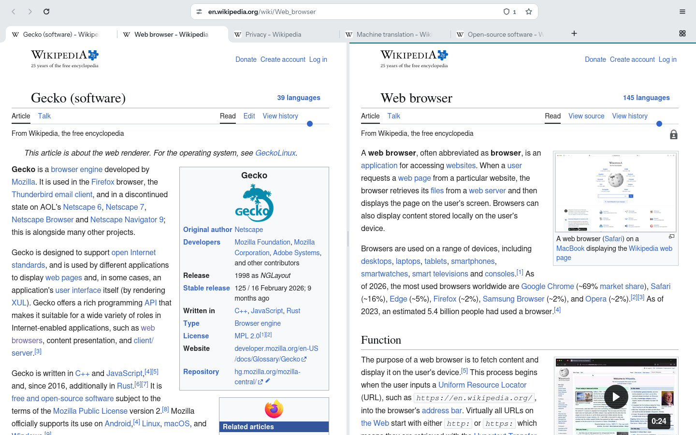
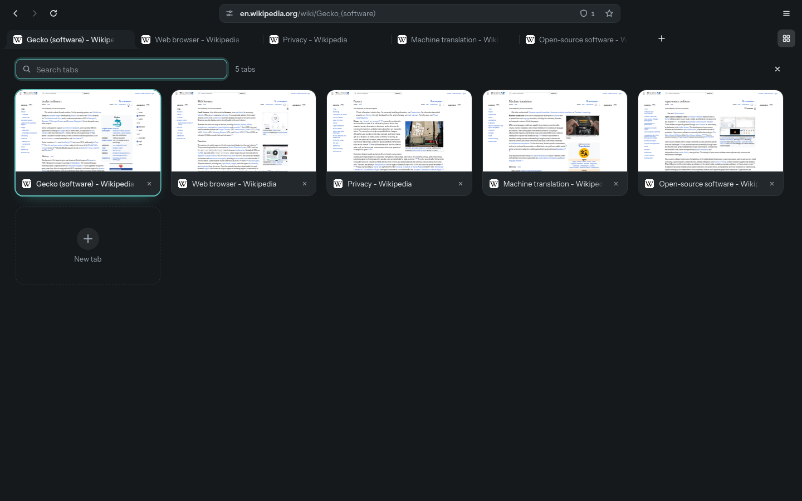
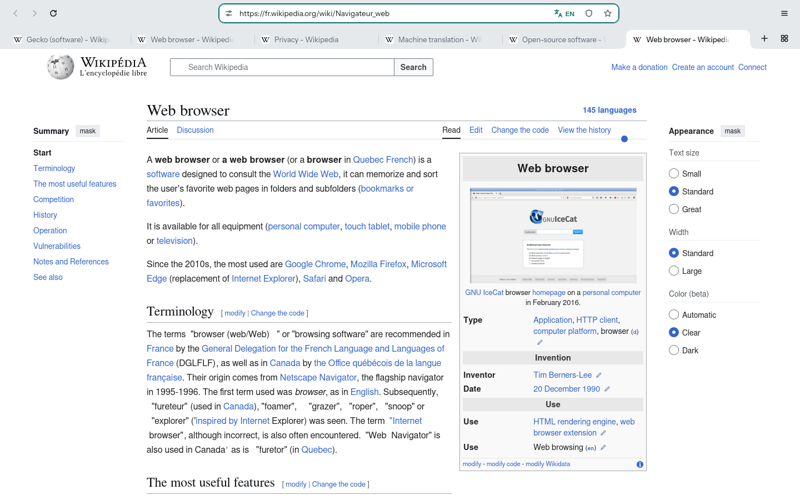
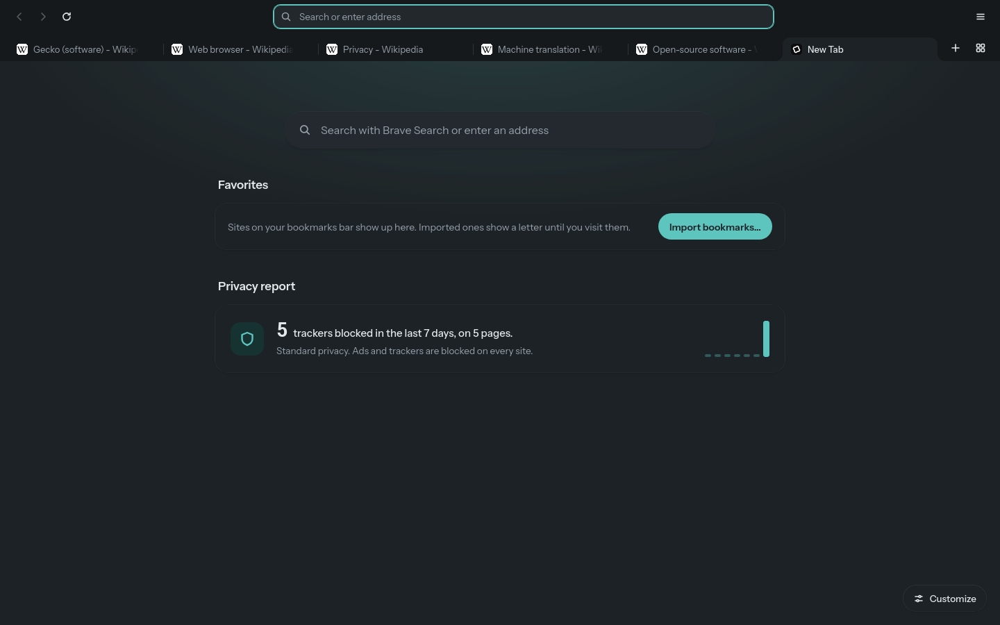
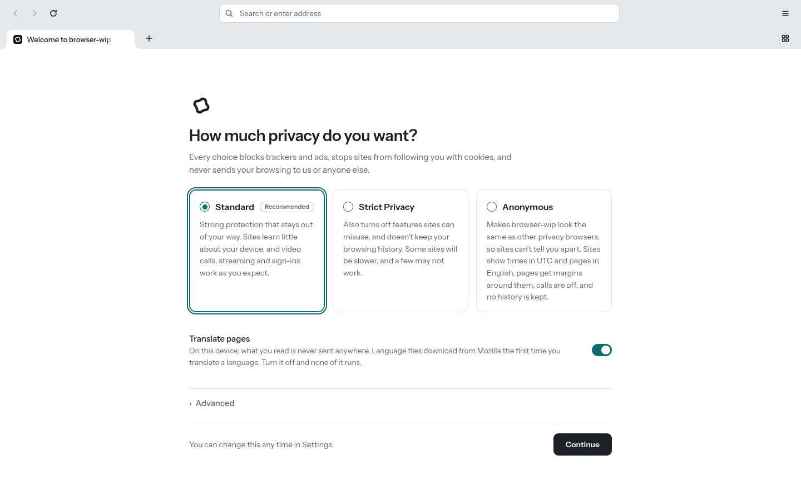
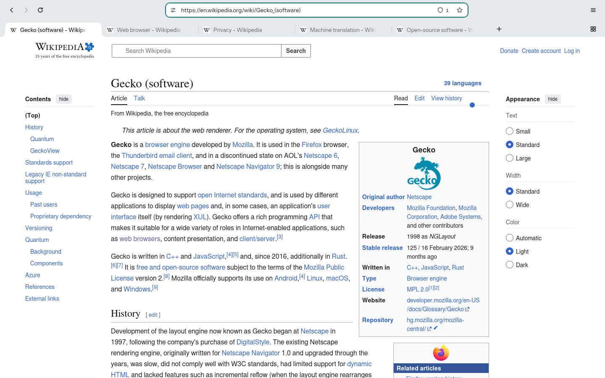
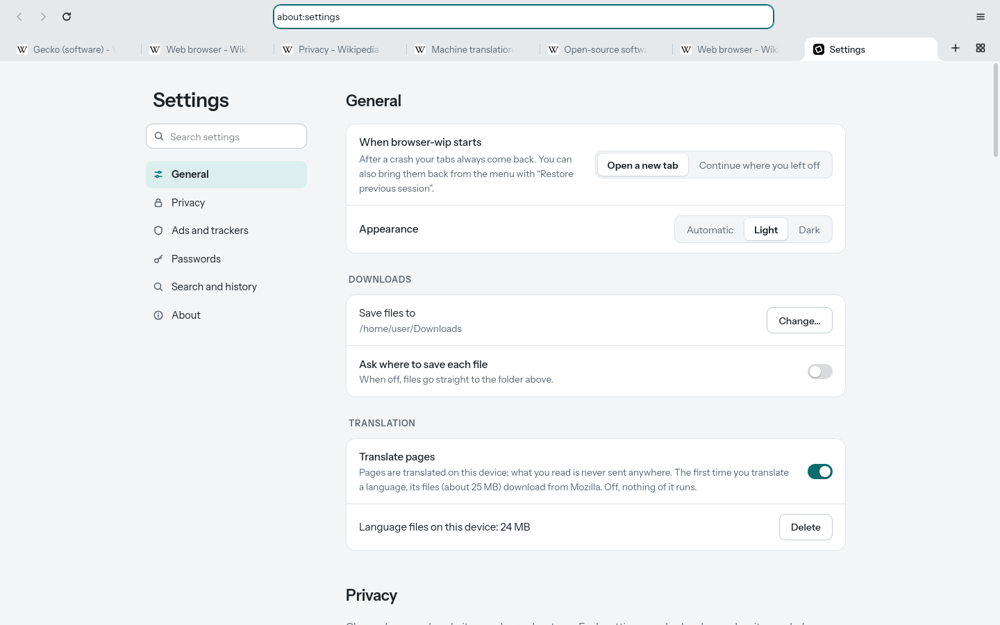

<p align="center">
  
</p>

<h1 align="center">browser-wip</h1>

<p align="center">
  <a href="https://github.com/C1ht/browser/releases"></a>
  
  
  <a href="LICENSE"></a>
</p>

<p align="center">
  <b>A private, fast web browser built on Firefox's engine, with a front end of its own.</b><br/>
  It blocks ads and trackers out of the box, never phones home, and keeps everything it does on your device.
</p>

<p align="center">
  <a href="#download"><kbd> Download </kbd></a>&nbsp;
  <a href="#features"><kbd> Features </kbd></a>&nbsp;
  <a href="#gallery"><kbd> Gallery </kbd></a>&nbsp;
  <a href="#build-from-source"><kbd> Build </kbd></a>&nbsp;
  <a href="docs/PLAN.md"><kbd> Design notes </kbd></a>
</p>

<p align="center">
  
</p>

> [!NOTE]
> browser-wip is in active development. Dev builds are unstable: expect bugs. `browser-wip` is a working name.

## Features

### Privacy
- **Three privacy modes**, picked on first run and changeable any time:
  - **Standard** blocks trackers and ads and stays out of your way.
  - **Strict Privacy** also turns off features sites can misuse.
  - **Anonymous** makes the browser look like other privacy browsers, so sites can't tell you apart.
- **No telemetry and no background calls home.** Nothing goes to Mozilla, Google or anyone else unless you ask for it, and an automated test checks that the browser stays silent.
- **Clear site data** for one site from the address bar, or for every site from Settings.

### Blocking
- **Built-in ad and tracker blocking**, on by default. No extension needed. It uses the EasyList, EasyPrivacy and Fanboy Social lists, shipped with the browser and never fetched in the background.
- **Empty ad slots are hidden** before the page first appears.
- **Scam and pop-under pages are blocked**, with a screen that lets you continue anyway.
- **The shield in the address bar** counts the trackers blocked on each page, and turns blocking off for one site.
- **Optional YouTube ad blocking**, using uBlock Origin's YouTube rules.

### Browsing
- **Split view:** drag a tab onto another tab to show the two pages side by side.
- **Tab overview:** every tab as a live card, with search. It zooms out of the page you're on and back into the one you pick.
- **Translate pages on your device.** What you read is never sent anywhere. Language files download from Mozilla the first time you use a language, or switch translation off completely.
- **Middle-click or Ctrl+click Back, Forward or Reload** to do it in a new tab.
- **Tabs you can drag** between windows or out into a new window. Tabs can also be pinned and muted.
- **Session restore** after a crash, or every time you start, if you like.
- **A new tab page** with your favorite sites and a weekly privacy report.
- **Bookmarks, history and downloads**, with a bookmarks bar and bookmark import.
- **Search with Brave Search**, or DuckDuckGo, Startpage or Mojeek. Search suggestions are off until you turn them on.

### Passwords
- **A built-in password manager** with its own encrypted vault (Argon2id and XChaCha20-Poly1305), locked by a master password.
- **A recovery key** in case you forget the master password.
- **Unlock with the system keyring** on Linux.
- **Password generator.** It saves logins when you sign in and fills them in, matching per subdomain.

### Everything else
- **Streaming that works.** Google's Widevine installs the first time a site needs it, so Netflix, Spotify and Disney+ play. It's on in Standard, off in Strict Privacy and Anonymous.
- **Printing and Save to PDF**, with Firefox's print preview.
- **Firefox's developer tools.**
- **Light and dark themes**, following your desktop or set by hand.
- **Decorations drawn by your desktop** on Linux.
- **Optional dev-build check:** tells you when a newer dev build is out.

## Gallery

<table>
  <tr>
    <td></td>
    <td></td>
  </tr>
  <tr>
    <td align="center"><sub>Tab overview, dark theme</sub></td>
    <td align="center"><sub>A French page, translated on the device</sub></td>
  </tr>
  <tr>
    <td></td>
    <td></td>
  </tr>
  <tr>
    <td align="center"><sub>New tab page and privacy report</sub></td>
    <td align="center"><sub>Choosing a privacy mode on first run</sub></td>
  </tr>
  <tr>
    <td></td>
    <td></td>
  </tr>
  <tr>
    <td align="center"><sub>Light theme, tabs below the address bar</sub></td>
    <td align="center"><sub>Settings</sub></td>
  </tr>
</table>

## Download

Dev builds for Linux (x86_64) are on the [releases page](https://github.com/C1ht/browser/releases). Each one lists what's new and what's fixed.

| System | Get | How |
|---|---|---|
| Any distribution | `.tar.zst` or `.tar.xz` | Extract it and run `browser-wip/browser-wip` |
| Any distribution, one file | `.AppImage` | `chmod +x` it and run it |
| Debian, Ubuntu | `.deb` | `sudo apt install ./browser-wip-….deb` |
| Fedora, openSUSE | `.rpm` | `sudo dnf install ./browser-wip-….rpm` |
| Arch Linux | `PKGBUILD` | Put it in an empty folder and run `makepkg -si` |

Check a download with `sha256sum -c SHA256SUMS --ignore-missing`. The packages aren't signed yet. Windows builds aren't available yet.

## Build from source

browser-wip is its own front end on top of an unmodified Firefox release (the version in [`GECKO_REVISION`](GECKO_REVISION)). The Firefox source sits next to this repository, and `app/` is mounted into it as the product directory.

```sh
tools/fetch-gecko.sh                 # the pinned Firefox release, in ../mozilla-central
sudo tools/setup-system-toolchain.sh # or: (cd ../mozilla-central && ./mach bootstrap)
cd ../mozilla-central
MOZCONFIG=$PWD/../browser/mozconfigs/dev ./mach build
./obj-browser-wip/dist/bin/browser-wip
```

- **Other distributions, or no root:** use `mozconfigs/dev-bootstrap` instead. It fetches Mozilla's toolchains into `~/.mozbuild` and needs only the GTK, X11 and Wayland development libraries, plus `unzip` and `zip`.
- **First build:** about 13 minutes on a 16-core machine, longer on fewer cores. `mozconfigs/dev` is tuned for 4 cores and about 13 GB of memory.
- **After that:** front-end changes need only `./mach build faster`.
- **App launcher:** to start your build from the desktop's launcher, run `tools/install-launcher.sh ../mozilla-central/obj-browser-wip/dist/bin`.

## Development

<details>
<summary><b>Checks</b></summary>

```sh
tests/unit/run.sh                                                     # no Gecko needed
tools/runtime/fetch-test-deps.sh                                      # once: strace, gnome-keyring and translation files
tools/runtime/check.py ../mozilla-central/obj-browser-wip/dist/bin    # runtime checks (headless), all parts
tools/netsilence/run.sh ../mozilla-central/obj-browser-wip/dist/bin   # no background network calls
tools/wayland-shot.sh <dist/bin> /tmp/p shot.png                      # screenshot on headless Weston
```

What the runtime checks can't cover headless, to check by hand: [docs/MANUAL-CHECKS.md](docs/MANUAL-CHECKS.md).
</details>

<details>
<summary><b>Dev builds</b></summary>

Dev builds are built, packaged and checked on the developer's machine, not on GitHub Actions:

```sh
tools/release/dev-release.sh --dry-run   # build, package, check and write the release notes; publish nothing
tools/release/dev-release.sh             # the same, then publish the pushed commit as a pre-release
```

- **Packages:** `.tar.zst`, `.tar.xz`, `.deb`, `.rpm`, `.AppImage` and an AUR `PKGBUILD`, with `SHA256SUMS`.
- **Checks before publishing:** each package is unpacked again and scanned for private keys, tokens and profile files. The PKGBUILD has to build with makepkg. The checksums have to match, locally and as GitHub serves the files.
- **Release notes** are made from the commit messages since the previous dev build (`tools/release/release_notes.py`). The format is in [CLAUDE.md](CLAUDE.md).
- **Update check:** each package carries `dev-build.json`, which the opt-in "Check for new dev builds" (Settings → About) compares with the newest release.
</details>

<details>
<summary><b>Repository layout</b></summary>

| Path | What it is |
|---|---|
| `app/` | The product directory, mounted into the Gecko tree as `browser-wip/` |
| `app/moz.configure` | Product identity, and build-time features: telemetry, crash reporter and updater off; DRM (Widevine) on |
| `app/profile/browser-wip.js` | Default prefs, which are the Standard privacy mode |
| `app/base/content/` | The browser window, tab strip, address bar, panels and the about: pages |
| `app/components/` | Privileged modules and actors: startup, privacy modes, blocking, passwords, translation, DRM, session store |
| `app/components/contentblocking/lists/` | The filter lists shipped with the browser (`tools/update-blocklists.py` refreshes them) |
| `app/components/translations/` | Page translation; the list of language files (`tools/update-translation-models.py` refreshes it) |
| `app/policies/` | The bundled enterprise policy that turns Remote Settings off |
| `app/themes/shared/` | The "Folio" styles, icons and the Instrument Sans font |
| `tools/` | Gecko checkout, toolchain setup, rename, release packaging, test tools |
| `tests/` | Unit tests (no Gecko needed), blocker cases and runtime test pages |
| `docs/` | Design and decisions ([PLAN.md](docs/PLAN.md)), [content blocking](docs/CONTENT-BLOCKING.md), [passwords](docs/PASSWORDS.md) |
</details>

## Special thanks

- [**Mozilla**](https://www.mozilla.org/): for Gecko and toolkit, the engine everything here runs on, and for Firefox Translations.
- [**EasyList**](https://easylist.to/): for the EasyList, EasyPrivacy and Fanboy's Social lists that block ads and trackers.
- [**uBlock Origin**](https://github.com/gorhill/uBlock): for the YouTube rules the optional YouTube blocker uses.
- [**Bergamot**](https://browser.mt/): for the on-device translation engine.
- [**libsodium**](https://libsodium.org/): for the cryptography in the password vault.
- [**Instrument Sans**](https://github.com/Instrument/instrument-sans): for the interface font.

## License

The code is under the [Mozilla Public License 2.0](LICENSE).

- **Instrument Sans:** SIL Open Font License 1.1 (`app/themes/shared/fonts/OFL.txt`).
- **Filter lists:** by the EasyList authors, under CC BY-SA 3.0, credited in Settings.
